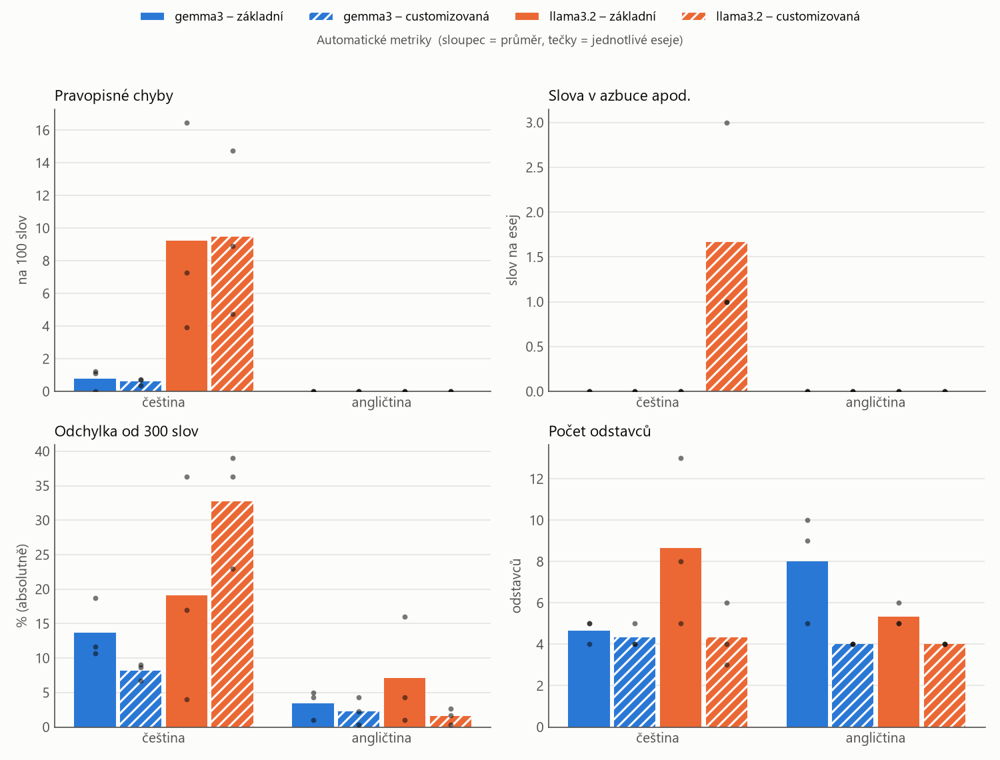
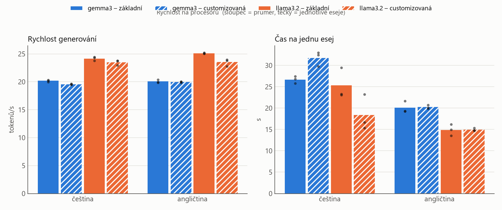
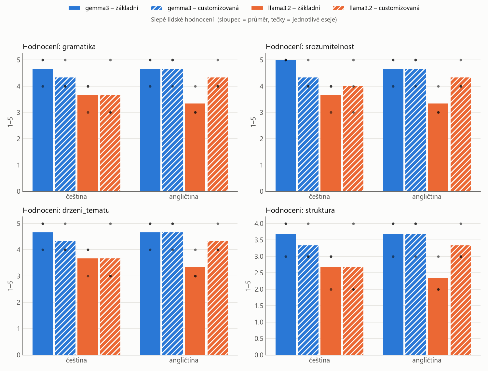

# Eseje v češtině a angličtině: gemma3:4b vs. llama3.2:3b

Školní experiment s lokálním jazykovým modelem (Ollama, jen procesor).
Repo obsahuje úlohu, postup, kód a výsledky. **Modely v něm nejsou**, stahují se z ollama.com.

## Úloha

Zjistit, který ze dvou malých lokálních modelů (do 4 GiB) napíše lepší krátkou esej
(cíl 300 slov) **v češtině** a **v angličtině**. Zároveň zjistit, jestli pomůže
customizace modelu přes Modelfile (systémový prompt + parametry).

| Model | Velikost | Proč |
|---|---|---|
| `gemma3:4b` (Google) | 3,3 GB | trénovaný na 140+ jazycích, mohl by umět česky |
| `llama3.2:3b` (Meta) | 2,0 GB | oficiálně podporuje 8 jazyků, čeština mezi nimi není |

## Hypotéza

1. V **angličtině** budou modely zhruba **vyrovnané**.
2. V **češtině** bude **lepší Gemma** (méně chyb, méně míchání jazyků, lepší hodnocení).
3. Customizovaná varianta bude lépe držet strukturu a délku než základní.

## Postup

### Prostředí

Windows 11, Intel Core i5-13500 (jen CPU, bez GPU), 32 GB RAM, Ollama 0.40.17
(přenosná verze), Python 3.11. Přesné údaje o běhu jsou v `vysledky/prostredi.json`.

### Návrh experimentu

- **5 témat** (`data/temata.json`), každé v české a anglické verzi; zadání je vždy
  v cílovém jazyce, např. *„Napiš esej v češtině na téma: … Rozsah asi 300 slov.“*
- **2 modely × 2 varianty × 2 jazyky × 3 témata = 24 esejí**. Připravených je 5 témat
  (40 esejí), kvůli času ve vyučovací hodině se generovala jen témata 1–3. Generuje se
  po tématech, takže i zkrácený běh má vyvážená data; zbytek doplní `python generuj.py`.
  - *základní*: model tak, jak je na ollama.com (výchozí parametry, bez systémového promptu)
  - *customizovaná*: `modelfiles/*.Modelfile`
- Stejný seed (42) pro všechna generování; jedna esej na kombinaci.

### Customizace (Modelfile)

Oba Modelfily jsou **stejné až na řádek `FROM`**, aby se modely lišily jen samy sebou:

- systémový prompt: piš jen v jazyce zadání (u češtiny s diakritikou, bez přechodu do
  angličtiny/slovenštiny), titulek + úvod + 2–3 odstavce + závěr, prostý text bez Markdownu
  a odrážek, drž se tématu a délky, vrať jen esej
- `temperature 0.7` (Gemma má výchozí 1.0), `top_p 0.9`
- `num_predict 1024` (300 slov ≈ 400–800 tokenů podle jazyka; limit zastaví zacyklení)
- `num_ctx 4096`

Základní varianta dostává ve skriptu jen pojistku `num_predict 1500` proti nekonečnému generování.

### Měření

**Rychlost** (`generuj.py`, z odpovědi Ollamy): `eval_count`, `eval_duration` → tokeny/s,
celkový čas, `done_reason` (`length` = esej useknutá limitem).

**Automatické metriky** (`metriky.py`, vše offline):

| Metrika | Jak |
|---|---|
| pravopisné chyby na 100 slov | slovo neznámé Hunspell slovníku `cs_CZ`, resp. `en_US`/`en_GB` (knihovna spylls) |
| věty ve špatném jazyce | `langdetect` po větách (≥ 3 slova); když vrátí jiný jazyk, věta se ještě ověří slovníkem – pokud ≥ 70 % slov je ve slovníku cílového jazyka, jde o falešný poplach* |
| odchylka od cílové délky | (počet slov − 300) / 300 |
| počet odstavců | neprázdné řádky, které nejsou nadpis |
| slova v cizím písmu | slova s nelatinkovými písmeny (azbuka) – přidáno po zkušebním běhu |
| opakované věty | podíl vět, které se v eseji doslova opakují – přidáno po zkušebním běhu |
| Markdown | obsahuje `**`, `#` nebo odrážky (porušení pokynu „prostý text“) |

\* langdetect označoval krátké české věty jako slovenštinu (*„Práce z domova má mnoho výhod.“* → `sk`).
Pro srovnání se ukládá i podíl jen podle langdetectu (`podil_spatny_jazyk_ld`).

**Slepé lidské hodnocení** (`priprav_hodnoceni.py` → `odkryj.py`): eseje dostanou
náhodné kódy E01…, hodnotitel nevidí model ani variantu. Rubrika 1–5:
gramatika, srozumitelnost, držení tématu, struktura.

### Jak experiment zopakovat

```powershell
pip install -r requirements.txt
python stahni_slovniky.py                 # jednou, Hunspell slovníky (jdou přes internet)

# v jiném okně: .\ollama.exe serve
.\ollama.exe pull gemma3:4b
.\ollama.exe pull llama3.2:3b
.\ollama.exe create gemma3-esej   -f modelfiles\gemma3-esej.Modelfile
.\ollama.exe create llama3.2-esej -f modelfiles\llama3.2-esej.Modelfile

python generuj.py                         # eseje -> vystupy/, měření -> vysledky/generace.jsonl
python metriky.py                         # -> vysledky/metriky.csv
python priprav_hodnoceni.py               # -> hodnoceni/ (slepý list)
#   ... vyplnit hodnoceni/hodnotici_list.csv (1–5) ...
python odkryj.py                          # -> vysledky/spojene.csv
python vyhodnoceni.py                     # -> vysledky/souhrn.md, vysledky/grafy/
```

Skripty v Pythonu volají Ollamu přes `ollama.Client(host="http://localhost:11434", trust_env=False)`,
aby dotaz nešel přes školní proxy.

## Struktura repa

```
data/temata.json          témata a šablona zadání
modelfiles/               Modelfily customizovaných variant
spolecne.py               cesty, seznam modelů, práce s textem
generuj.py                generování + měření rychlosti
metriky.py                automatické metriky
priprav_hodnoceni.py      slepý hodnoticí list
odkryj.py                 odkrytí modelů a spojení s metrikami
vyhodnoceni.py            tabulky a grafy
stahni_slovniky.py        stažení Hunspell slovníků (slovniky/ není v gitu)
vystupy/                  vygenerované eseje
vysledky/                 měření, metriky, souhrn.md, grafy/
hodnoceni/                hodnoticí list, eseje k hodnocení, klíč
```

## Výsledky

Kompletní tabulky jsou ve [`vysledky/souhrn.md`](vysledky/souhrn.md), data po esejích
ve `vysledky/metriky.csv` a `vysledky/generace.jsonl`, texty ve `vystupy/`.
Průměry přes 3 témata (n = 3 na buňku):

| jazyk | model | varianta | slov | odchylka délky % | chyb / 100 slov | slov v azbuce | Markdown |
|---|---|---|---|---|---|---|---|
| cs | gemma3 | základní | 259 | 13,7 | 0,78 | 0 | 3/3 |
| cs | gemma3 | custom | 276 | 8,1 | **0,60** | 0 | 0/3 |
| cs | llama3.2 | základní | 315 | 19,1 | 9,22 | 0 | 1/3 |
| cs | llama3.2 | custom | 202 | 32,8 | **9,47** | 1,7 | 0/3 |
| en | gemma3 | základní | 310 | 3,4 | 0,00 | 0 | 3/3 |
| en | gemma3 | custom | 298 | 2,3 | 0,00 | 0 | 0/3 |
| en | llama3.2 | základní | 313 | 7,1 | 0,00 | 0 | 0/3 |
| en | llama3.2 | custom | 301 | 1,6 | 0,00 | 0 | 0/3 |



**Rychlost** (jen CPU): llama3.2:3b ≈ 24 tokenů/s, gemma3:4b ≈ 20 tokenů/s. Esej trvala
15–35 s. České eseje potřebují víc tokenů než anglické (Gemma ~540 vs. ~380), protože
tokenizéry dělí češtinu na menší kousky. Žádná esej nebyla useknuta limitem tokenů.



### Co ukázaly texty

- **Angličtina:** oba modely bez pravopisných chyb, s délkou blízko 300 slov.
  Automatické metriky mezi nimi rozdíl nenašly.
- **Čeština – Gemma:** souvislý, čtivý text, chyby ojedinělé (anglické „remote work“,
  slovenské „neistoty“, nesprávné „podpořivém“).
- **Čeština – Llama:** do češtiny míchá slova z angličtiny, španělštiny („podemos“, „nuestra“),
  němčiny („einige“, „unsere“), indonéštiny („menjadi“, „sangat“), polštiny a ruštiny v azbuce
  („самых“, „многие“), vymýšlí neexistující slova („soucitovat“, „pracovičům“) a opakuje
  celé věty (až 18 % vět v eseji). Customizace to nezlepšila – eseje jen zkrátila (202 slov).
- **Customizace (Modelfile)** spolehlivě odstranila Markdown (Gemma ho bez ní měla ve všech
  esejích), sjednotila počet odstavců na 4–5 a v angličtině zpřesnila délku.

### Slepé lidské hodnocení

Jeden hodnotitel (autor experimentu), 24 esejí pod náhodnými kódy, známky 1–5.
Data po esejích: `hodnoceni/hodnotici_list.csv`, po odkrytí `vysledky/spojene.csv`.

| jazyk | model | varianta | gramatika | srozumitelnost | držení tématu | struktura | **průměr** |
|---|---|---|---|---|---|---|---|
| cs | gemma3 | základní | 4,67 | 5,00 | 4,67 | 3,67 | **4,50** |
| cs | gemma3 | custom | 4,33 | 4,33 | 4,33 | 3,33 | **4,08** |
| cs | llama3.2 | základní | 3,67 | 3,67 | 3,67 | 2,67 | **3,42** |
| cs | llama3.2 | custom | 3,67 | 4,00 | 3,67 | 2,67 | **3,50** |
| en | gemma3 | základní | 4,67 | 4,67 | 4,67 | 3,67 | **4,42** |
| en | gemma3 | custom | 4,67 | 4,67 | 4,67 | 3,67 | **4,42** |
| en | llama3.2 | základní | 3,33 | 3,33 | 3,33 | 2,33 | **3,08** |
| en | llama3.2 | custom | 4,33 | 4,33 | 4,33 | 3,33 | **4,08** |



- **Čeština:** Gemma hodnocena lépe než Llama (průměr 4,29 vs. 3,46) – shoda s automatickými metrikami.
- **Angličtina:** Gemma 4,42, Llama 3,58 – lidské hodnocení vidí rozdíl i tam, kde automatické
  metriky žádný nenašly (pravopis je u obou bezchybný; rozdíl je v obsahu a stylu).
- **Customizace** u Llamy v angličtině zvedla hodnocení z 3,08 na 4,08; u Gemmy hodnocení
  nezlepšila (v češtině mírně horší, 4,08 vs. 4,50).

**Výhrady k hodnocení:**

- Hodnotil jen jeden člověk, n = 3 na buňku – rozdíly 0,3–0,5 bodu mohou být náhoda.
- Kritéria nebyla hodnocena nezávisle: u 23 z 24 esejí platí gramatika = srozumitelnost =
  držení tématu a struktura = o 1 méně. Rubrika tak fakticky funguje jako jedna celková známka.
- Hodnocení se místy rozchází s automatickými metrikami: esej E06 (llama3.2 custom, cs)
  dostala za gramatiku 5, ačkoli obsahuje slova v azbuce a 18 % opakovaných vět.
- Základní Gemma píše Markdown (`**tučně**`), takže ji hodnotitel mohl poznat – hodnocení
  nebylo úplně slepé.

### Omezení experimentu

- Jen **3 témata × 1 generování** na kombinaci (n = 3) – žádné statistické testy,
  výsledky jsou orientační. Rozdíl v češtině je ale tak velký, že ho n = 3 ukazuje jasně.
- **„Věty ve špatném jazyce“ vyšly všude 0 %**, i když Llama cizí slova míchá. Chyba
  není ve větách celých v jiném jazyce, ale v jednotlivých slovech uvnitř českých vět –
  to zachycuje metrika pravopisných chyb a slov v cizím písmu, ne detekce jazyka po větách.
- Hunspell počítá jako chybu i správná slova, která nezná (vlastní jména, nové výrazy),
  a nepozná gramatické chyby ve správně napsaných slovech (shoda, pády).
- Systémový prompt je anglicky; český prompt by mohl češtině pomoct.

## Závěr

**Hypotéza se potvrdila jen zčásti:**

1. V angličtině jsou modely vyrovnané **jen podle automatických metrik** (oba bez chyb,
   drží délku i strukturu). Lidské hodnocení dalo Gemmě víc (4,42 vs. 3,58), takže
   „vyrovnané“ platí pro pravopis a formu, ne pro celkovou kvalitu textu.
2. V češtině je **Gemma výrazně lepší**: ~0,7 vs. ~9,3 pravopisných chyb na 100 slov
   (zhruba 13× méně) a lepší lidské hodnocení (4,29 vs. 3,46). Llama 3.2 3B česky
   použitelně nepíše – míchá jazyky a vymýšlí slova. **Tato část hypotézy se potvrdila.**
3. Customizace pomohla hlavně **formě** (bez Markdownu, správný počet odstavců, délka),
   **pravopis nezlepšila** – ten určuje základní model. V lidském hodnocení pomohla jen
   Llamě v angličtině (3,08 → 4,08), u Gemmy ne.

**Šlo by to použít?**

- **Anglické eseje:** ano, oba modely – Gemma píše o něco lépe, Llama je o ~20 % rychlejší
  a menší (2 GB). Llamu používat jen v customizované variantě (lidské hodnocení 4,08 vs. 3,08).
- **České eseje:** jen **gemma3:4b**, a to jako *koncept k úpravě*, ne hotový text –
  občas se objeví slovenské nebo anglické slovo. llama3.2:3b pro češtinu nepoužívat.

**Co je potřeba splnit:**

- počítač s ~6 GB volné RAM a ~4 GB na disku; GPU není nutná (esej za 15–35 s na CPU)
- použít customizovaný Modelfile (jinak model vrací Markdown a nedrží strukturu)
- výstup v češtině vždy zkontrolovat (kontrola pravopisu + přečtení člověkem)
- pro spolehlivější závěr: všech 5 témat, víc generování na kombinaci (různé seedy),
  hodnocení od více hodnotitelů, kteří hodnotí každé kritérium zvlášť
